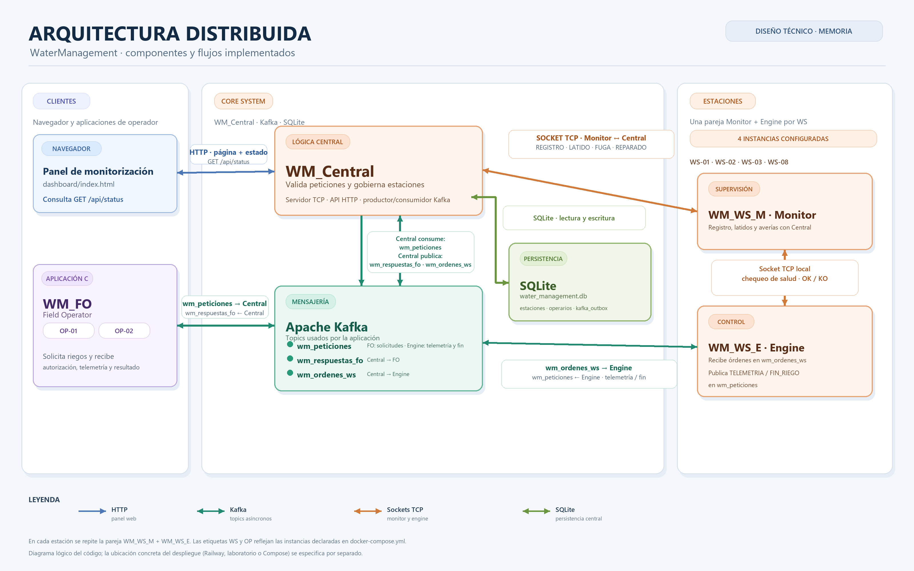

# WaterManagement

Práctica de Sistemas Distribuidos (curso 26/27, Universidad de Alicante) realizada por Keilyn Yuranis Conde Dávila y Dana Nahiara Meza Castañeda.

Sistema distribuido para simular y supervisar una red de estaciones de riego. Está compuesto por una Central, aplicaciones de operario (FO) y dos procesos por estación: Monitor (WS_M) y Engine (WS_E). Central almacena el estado de la red en SQLite; los componentes intercambian peticiones y eventos mediante Apache Kafka y sockets TCP. Todo el código está escrito en C.



## Estructura del repositorio

```
WM_Central/WM_Central.c   Central: sockets, Kafka, SQLite, menú y panel web
WM_WS/WM_WS_M.c           Monitor de estación
WM_WS/WM_WS_E.c           Engine de estación (riego y telemetría)
WM_FO/WM_FO.c             Aplicación del operario
dashboard/index.html      Panel de monitorización que sirve Central
config/estaciones.txt     Estaciones autorizadas (ID#Ubicación)
config/operarios.txt      Operarios autorizados (ID#Nombre)
rutinas.txt               Estaciones que pide el FO en modo automático
Dockerfile*               Imágenes de Central, FO, Monitor y Engine
docker-compose.yml        Escenario completo en local
prompts/prompts.md        Consultas de referencia usadas durante el desarrollo
```

## Componentes

- `WM_Central/WM_Central.c`: registra y supervisa estaciones, procesa peticiones, mantiene la base de datos y sirve el panel web.
- `WM_FO/WM_FO.c`: aplicación de operario para consultar estaciones y solicitar riegos.
- `WM_WS/WM_WS_M.c`: monitor de estación; comunica su registro, latidos e incidencias a Central y comprueba el estado del Engine.
- `WM_WS/WM_WS_E.c`: ejecuta las órdenes de riego, genera telemetría y comunica el resultado del servicio.
- `dashboard/index.html`: panel de monitorización de Central.
- `config/estaciones.txt`: estaciones autorizadas, con formato `ID#Ubicación`.
- `config/operarios.txt`: operarios autorizados, con formato `ID#Nombre`.
- `prompts/prompts.md`: consultas de referencia relacionadas con el desarrollo y la depuración del sistema.

### WM_Central

Es el núcleo del sistema. Atiende a los Monitor por sockets TCP (un proceso hijo por conexión, así puede atender a varias estaciones a la vez) y procesa por Kafka las peticiones de los operarios y los eventos de los Engine. Internamente lanza varios hilos: consumidor de Kafka, publicador de mensajes pendientes, vigilancia de latidos, menú y panel HTTP.

Menú de Central:

1. Iniciar riego manualmente en una estación.
2. Bloquear una estación (pasa a `FUERA_SERVICIO` y se detiene el riego en curso).
3. Activar una estación bloqueada.

En las tres opciones se puede indicar el ID de una estación o `TODAS`.

### WM_WS_M (Monitor)

Al arrancar se registra en Central (reintenta hasta 20 veces, una por segundo, por si Central todavía no está levantada). Después:

- Envía un latido a Central cada segundo con el estado de la estación (`OK` o `FUGA`).
- Abre un puerto local al que se conecta el Engine y le envía una comprobación cada segundo. Si el Engine responde `KO` o se desconecta, avisa a Central de la avería.
- En cada comprobación le indica al Engine si Central está disponible, para que no acepte riegos nuevos si Central ha caído.

Menú del Monitor: notificar una avería manualmente o notificar que la estación está reparada.

### WM_WS_E (Engine)

Recibe las órdenes de Central por Kafka y simula el riego: cada segundo calcula el caudal, acumula el volumen y publica la telemetría. Un riego dura como máximo 300 segundos y termina antes si hay una fuga o una orden de parada. Al terminar publica un resumen (`FIN_RIEGO`) con el volumen, la duración y la causa (`NORMAL`, `FUGA`, `DETENIDO` o `ENGINE_DESCONECTADO`).

Menú del Engine:

1. Provocar una fuga (el Monitor la detecta en la siguiente comprobación).
2. Reparar la fuga.
3. Iniciar un riego manualmente desde la estación.
4. Finalizar el riego en curso.

### WM_FO (operario)

Tiene dos modos:

- **Automático**: si recibe un fichero de rutinas, pide riego en cada estación del fichero, una detrás de otra, esperando 4 segundos entre un servicio y el siguiente.
- **Manual**: sin fichero, se escribe el ID de una estación para pedir riego, `listar` para ver las estaciones disponibles o `salir`.

Durante el riego el FO muestra la telemetría que le reenvía Central y, al terminar, el resumen del servicio. Si Central no responde en 15 segundos muestra un error y conserva la petición pendiente para retomarla al volver a arrancar.

### Panel web

Central sirve `dashboard/index.html` en el puerto HTTP. La página consulta `GET /api/status` cada segundo y muestra el estado de Central, la última petición o evento y una tabla con cada estación (estado, caudal, volumen y operario). La API devuelve un JSON con este formato:

```json
{
  "central": "OPERATIVA",
  "ultima_peticion": "Operario OP-01 solicitó WS-01 -> AUTORIZADO",
  "stations": [
    { "id": "WS-01", "ubicacion": "Parque Principal", "estado": "REGANDO",
      "caudal": 330.0, "volumen": 27.5, "operario": "OP-01" }
  ]
}
```

## Estados de una estación

| Estado | Significado |
|---|---|
| `DESCONECTADA` | Central no recibe latidos del Monitor (estado inicial al arrancar Central) |
| `DISPONIBLE` | Conectada y lista para regar |
| `REGANDO` | Tiene un riego en curso |
| `FUGA` | El Monitor ha informado de una avería o el Engine se ha desconectado |
| `FUERA_SERVICIO` | Bloqueada desde el menú de Central |

Cuando una estación se desconecta, Central guarda el estado que tenía para restaurarlo cuando vuelvan a llegar latidos.

## Comunicaciones

Kafka se utiliza con estos tres topics:

- `wm_peticiones`: recibe solicitudes de FO y eventos del Engine, incluida la telemetría y el fin de riego.
- `wm_ordenes_ws`: distribuye órdenes de Central a los Engine.
- `wm_respuestas_fo`: entrega a FO las respuestas y los resultados procesados por Central.

Los topics contienen mensajes de texto con campos separados por `#`. La telemetría viaja como evento dentro de `wm_peticiones`.

Los sockets TCP cubren la comunicación entre Monitor y Central, y el enlace local entre Monitor y Engine. En el escenario Docker, Central escucha a los Monitor en el puerto `8080`; el panel HTTP de Central se publica en el puerto `8081`.

### Mensajes por socket

Monitor → Central (Central contesta `STATUS#OK#...` o `STATUS#ERROR#...`):

| Mensaje | Uso |
|---|---|
| `REGISTRO#<id>#<ubicación>` | Alta de la estación; se rechaza si el ID no está en `estaciones.txt` |
| `LATIDO#<id>#OK` / `LATIDO#<id>#FUGA` | Latido cada segundo |
| `AVERIA#<id>#FUGA` / `AVERIA#<id>#ENGINE_DESCONECTADO` | Avería detectada |
| `REPARADO#<id>` | La estación vuelve a estar bien |

Monitor ↔ Engine (socket local): el Monitor envía `PING`, `DETENER_FUGA` o `RESTABLECER` seguido de `#CENTRAL_OK` o `#CENTRAL_KO`, y el Engine responde `OK` o `KO`.

### Mensajes por Kafka

| Topic | Mensaje | Emisor |
|---|---|---|
| `wm_peticiones` | `<op>#<ws>` (petición de riego), `<op>#LISTAR` | FO |
| `wm_peticiones` | `TELEMETRIA#<ws>#<caudal>#<volumen>`, `FIN_RIEGO#<ws>#<volumen>#<segundos>#<causa>`, `<ws>#INICIO_RIEGO#MANUAL_WS` | Engine |
| `wm_ordenes_ws` | `<ws>#INICIAR_RIEGO#<op>`, `<ws>#FUERA_SERVICIO#DETENER_RIEGO`, `<ws>#ACTIVAR_ESTACION` | Central |
| `wm_respuestas_fo` | `<op>#<ws>#AUTORIZADO`, `DENEGADO`, `ERROR_NO_EXISTE`, `ERROR_OPERARIO`, `ERROR_AVERIA`, `TELEMETRIA`, `FIN_RIEGO`, `LISTA` y `LISTA_FIN` | Central |

## Tiempos principales

- Latido del Monitor: cada 1 s. Central marca la estación como `DESCONECTADA` tras 15 s sin latidos.
- Al arrancar, el Monitor espera 10 s a que el Engine se reconecte antes de informar de una avería.
- Riego: máximo 300 s, con telemetría cada segundo.
- FO automático: 4 s entre servicios. El FO espera 15 s la respuesta de Central (120 s si la estación ha tenido una avería durante el riego).
- Si un FO, Engine o Central se cierra sin avisar, Kafka libera su grupo de consumo a los 6 s y la siguiente instancia vuelve a recibir mensajes.

## Ejecución local

Desde la raíz del repositorio, Docker Compose construye y arranca los servicios:

```bash
docker compose up --build -d
```

El panel está disponible en [http://localhost:8081](http://localhost:8081). La API que utiliza el panel es `GET /api/status`. Para seguir los mensajes de Central:

```bash
docker compose logs -f central
```

Para usar el menú de un componente hay que engancharse a su contenedor (para salir sin pararlo: `Ctrl+P` y después `Ctrl+Q`):

```bash
docker compose attach central
docker compose attach ws_e
docker compose attach fo_02
```

El escenario se detiene con:

```bash
docker compose down
```

La configuración actual de Compose incluye cuatro pares Monitor/Engine (`WS-01`, `WS-02`, `WS-03` y `WS-08`) y dos procesos FO (`OP-01` y `OP-02`). La base de datos de Central se conserva en `db_data/`; FO y Engine usan volúmenes independientes para sus datos locales. `OP-01` arranca en modo automático con `rutinas.txt` y `OP-02` en modo manual. Para empezar de cero también con los datos locales de FO y Engine se puede usar `docker compose down -v`.

## Configuración

Central carga al inicio las identidades de `config/estaciones.txt` y `config/operarios.txt`. Los identificadores de estación y operario deben coincidir con los usados por los servicios de Compose. La lista `rutinas.txt` contiene también `WS-99`, que no figura entre las estaciones autorizadas y permite observar el rechazo de una solicitud.

Los ejecutables reciben sus direcciones y puertos mediante argumentos:

- Central: `central_app <puerto_tcp> <broker:puerto> [puerto_http]`. Si no se indica el puerto HTTP usa el 8081, o la variable `PORT` si existe (útil en Railway).
- Monitor: `WM_WS_M <host_central> <puerto_central> <puerto_local_engine> <id_ws> <ubicación>`.
- Engine: `WM_WS_E <broker:puerto> <host_monitor> <puerto_monitor> <id_ws>`.
- FO: `fo_app <broker:puerto> <id_operario> [fichero_rutinas]`.

Los nombres `broker`, `central` y los nombres de servicio de Compose resuelven dentro de la red Docker local. Para ejecutar componentes en equipos distintos, cada proceso necesita recibir la dirección de red alcanzable del servicio correspondiente.

## Compilación sin Docker

En Ubuntu hacen falta `gcc`, `librdkafka-dev` y `libsqlite3-dev`:

```bash
gcc -o central_app WM_Central/WM_Central.c -lsqlite3 -lrdkafka -lpthread
gcc -o WM_WS_M WM_WS/WM_WS_M.c -lpthread
gcc -o WM_WS_E WM_WS/WM_WS_E.c -lrdkafka -lpthread
gcc -o fo_app WM_FO/WM_FO.c -lrdkafka
```

Central debe ejecutarse desde la raíz del repositorio para encontrar `config/` y `dashboard/`.

## Persistencia local

Central mantiene en SQLite el estado de las estaciones y una cola de salida para los mensajes Kafka pendientes. Engine conserva eventos pendientes y el estado de un riego en sus datos locales; FO guarda la información necesaria para recuperar una operación pendiente. Estas persistencias permiten reintentar entregas después de reinicios. Un mensaje puede volver a publicarse si el proceso se interrumpe después de que Kafka lo acepte y antes de registrar la entrega localmente.

Más en detalle:

- **Central** no publica directamente en Kafka: guarda cada mensaje en la tabla `kafka_outbox` dentro de la misma transacción que el cambio de estado, y un hilo aparte lo publica y lo marca como entregado. Los offsets de `wm_peticiones` se confirman a mano solo cuando el resultado ya está guardado en la base de datos.
- **Engine** guarda la telemetría y el fin de riego en un fichero de salida antes de publicarlos, y lleva un diario del riego (`ACTIVE`, `FIN_PENDING`, `FIN_SENT`). Si se cae regando, al volver envía el resumen con lo que llevaba regado. También guarda la partición y el offset de la última orden para no repetir un riego si Kafka se la vuelve a entregar.
- **FO** guarda en `fo_data/operacion_pendiente.txt` la estación y la línea del fichero por la que iba, de modo que al reiniciarse continúa donde lo dejó.
- Los productores usan `acks=all` e idempotencia para que Kafka confirme cada mensaje sin duplicarlo en los reintentos.

## Pruebas habituales

| Prueba | Resultado esperado |
|---|---|
| Pedir riego en una estación disponible | El FO recibe `AUTORIZADO`, ve la telemetría y al final el resumen |
| Pedir `WS-99` | Central responde `ERROR_NO_EXISTE` |
| Operario que no está en `operarios.txt` | Central responde `ERROR_OPERARIO` |
| Pedir una estación ocupada, bloqueada o con avería | Central responde `DENEGADO` |
| Opción 1 del Engine durante un riego | La estación pasa a `FUGA`, el riego se corta y el FO recibe el aviso |
| Parar el contenedor de un Engine | El Monitor informa de `ENGINE_DESCONECTADO` y la estación pasa a `FUGA` |
| Parar el contenedor de un Monitor | A los 15 s la estación aparece `DESCONECTADA`; el riego en curso no se interrumpe |
| Parar Central | Los Engine no aceptan riegos nuevos y el FO avisa de que no puede conectar; al volver Central se recupera el estado |
| Bloquear y activar desde el menú de Central | La estación pasa a `FUERA_SERVICIO` y vuelve a `DISPONIBLE` |

## Ejecución en equipos distintos

Central y Kafka se despliegan en la nube; las estaciones y los FO se lanzan en los equipos del laboratorio. Desde la raíz del repositorio se construyen las imágenes:

```bash
docker build -f Dockerfile.WS_M -t wm_ws_m .
docker build -f Dockerfile.WS_E -t wm_ws_e .
docker build -f Dockerfile.FO -t wm_fo .
```

Cada estación es un par Monitor/Engine en la misma red Docker; el FO conserva su operación pendiente en un volumen:

```bash
docker network create wm_red
docker run -it --name wsm1 --network wm_red wm_ws_m ./WM_WS_M <host_central> <puerto_central> 5000 WS-01 "Parque Principal"
docker run -it --name wse1 --network wm_red -v wse1_data:/app/engine_data wm_ws_e ./WM_WS_E <host_kafka:puerto> wsm1 5000 WS-01
docker run -it --name fo1 -v fo1_data:/app/fo_data wm_fo ./fo_app <host_kafka:puerto> OP-01
```

Para lanzar más estaciones en el mismo equipo basta con repetir el par cambiando el nombre de los contenedores, el puerto local y el ID (por ejemplo `wsm2`, `wse2`, `5001` y `WS-02`). Los ID tienen que estar en `config/estaciones.txt` de Central.

En la nube, Central necesita dos accesos: el puerto TCP al que se conectan los Monitor y el puerto HTTP del panel. Kafka tiene que anunciar (`advertised.listeners`) una dirección que sea alcanzable desde los equipos del laboratorio, porque es la que usan Engine y FO para conectarse.

## Release 2 (en desarrollo)

Este mismo repositorio se ampliará con la segunda parte de la práctica:

- WM_Registry: alta y baja de estaciones mediante una API REST por HTTPS.
- Autenticación de las estaciones en Central y clave de cifrado propia para cada estación, con opción para revocarla.
- Cifrado de los mensajes entre Central y las estaciones.
- Registro de auditoría de los eventos en Central.
- API_Central y un Front web que la consulte.
- WM_W: consulta del clima en OpenWeather para suspender el riego con heladas o lluvia.
